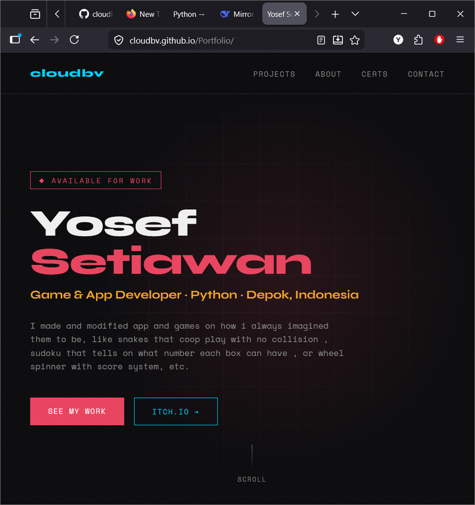
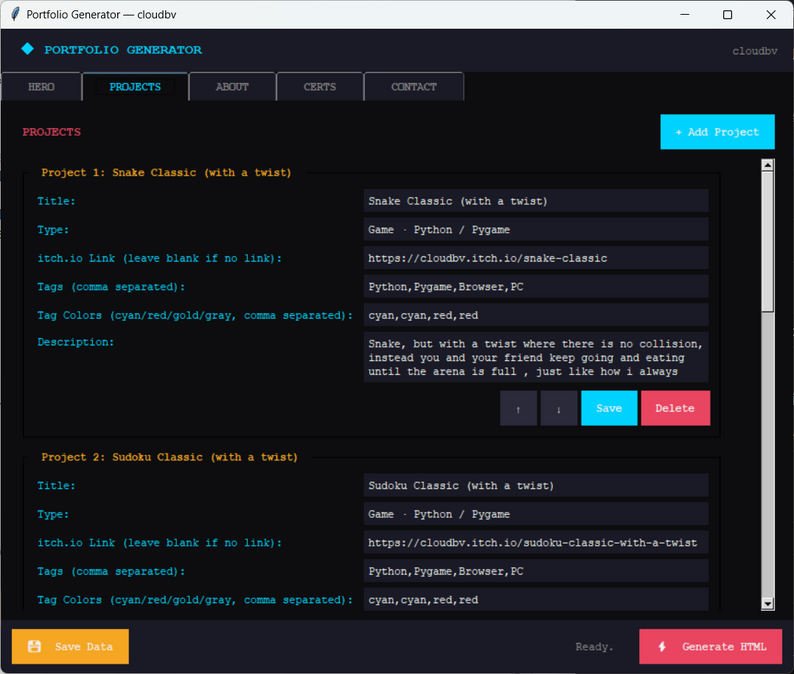
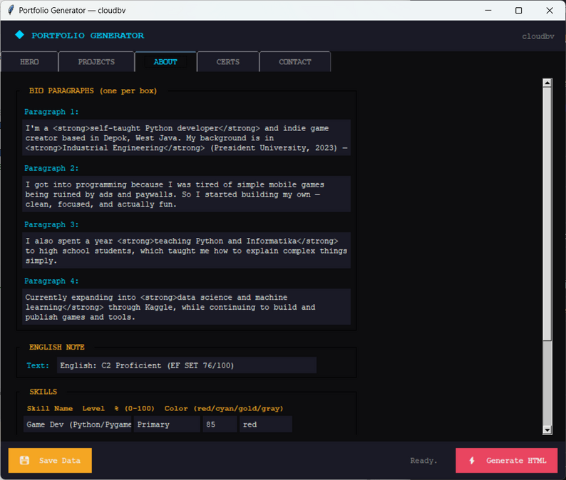
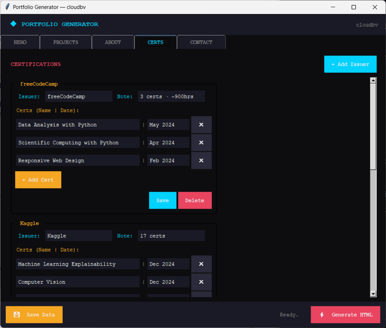
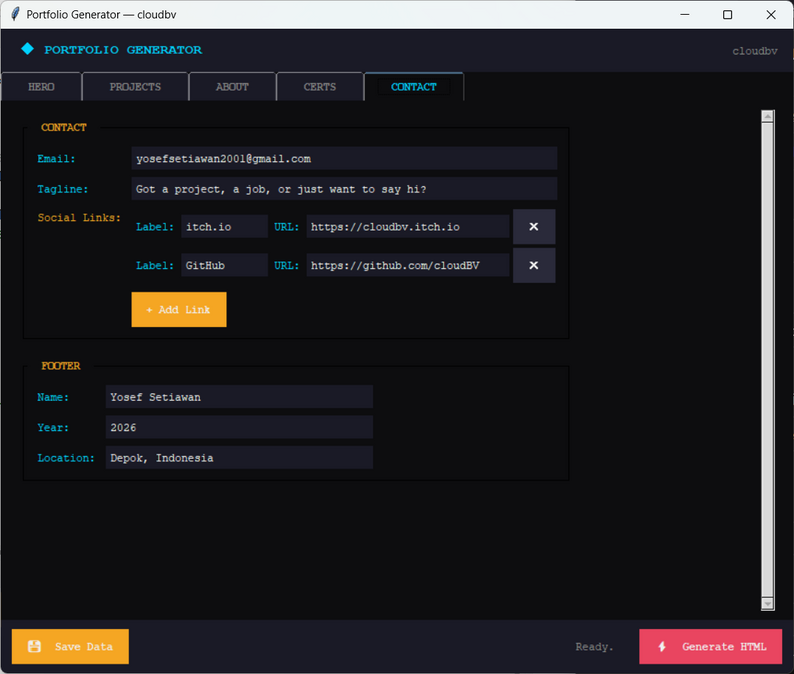

# Portfolio Maker

A small desktop app that builds your portfolio website for you. Fill in a form, click one button, and get a finished single-page site you can host for free on GitHub Pages. No HTML or CSS needed.

**Project page:** https://cloudbv.github.io/portofolio_maker/
**Download on itch.io:** https://cloudbv.itch.io/portfolio-maker
**Example of a site it made:** https://cloudbv.github.io/Portfolio/



## How it works

1. Open the app and fill in the tabs.
2. Click **Generate HTML**. The app writes `index.html` next to the script.
3. Upload `index.html` to a GitHub repo and turn on GitHub Pages.

Your content is saved to `portfolio_data.json`, so you can close the app and keep editing later.

## What you can edit

| Tab | What it controls |
| --- | --- |
| **Hero** | Name, subtitle, short intro, itch.io button link, optional "Available for work" tag |
| **Projects** | Project cards with title, type, description, link and coloured tags. Add, delete and reorder them |
| **About** | Bio paragraphs (basic HTML like `<strong>` works), an English-level note, and skill bars with level, percentage and colour |
| **Certs** | Certificates grouped by issuer, each with a date |
| **Contact** | Email, tagline, any number of social links, and the footer |

## Screenshots

| Projects | About |
| --- | --- |
|  |  |

| Certs | Contact |
| --- | --- |
|  |  |

## Run it

You need [Python 3](https://www.python.org/downloads/). Tkinter comes with it, so there is nothing else to install.

```bash
python portfolio_generator.py
```

Edit your details, then press **Save Data** or **Generate HTML**.

> The app writes `index.html` into the folder it runs from. If you run it inside a repo that already has an `index.html`, it will be overwritten.

## Publish with GitHub Pages

1. Create a repo and upload the generated `index.html` to the root.
2. Open **Settings → Pages**.
3. Under **Build and deployment**, choose **Deploy from a branch**, pick `main` and the `/ (root)` folder, then save.
4. After a minute your site is live at `https://username.github.io/repo-name/`.

## Files in this repo

| File | Purpose |
| --- | --- |
| `portfolio_generator.py` | The app: editor window and HTML generator in one file |
| `portfolio_data.json` | Your saved content, created the first time you save |
| `index.html` | The project page you can see at the link above |
| `screenshot-*.png` | Images used by the project page and this README |

## Author

Made by Yosef Setiawan in Depok, Indonesia.
[GitHub](https://github.com/cloudBV) · [itch.io](https://cloudbv.itch.io)
